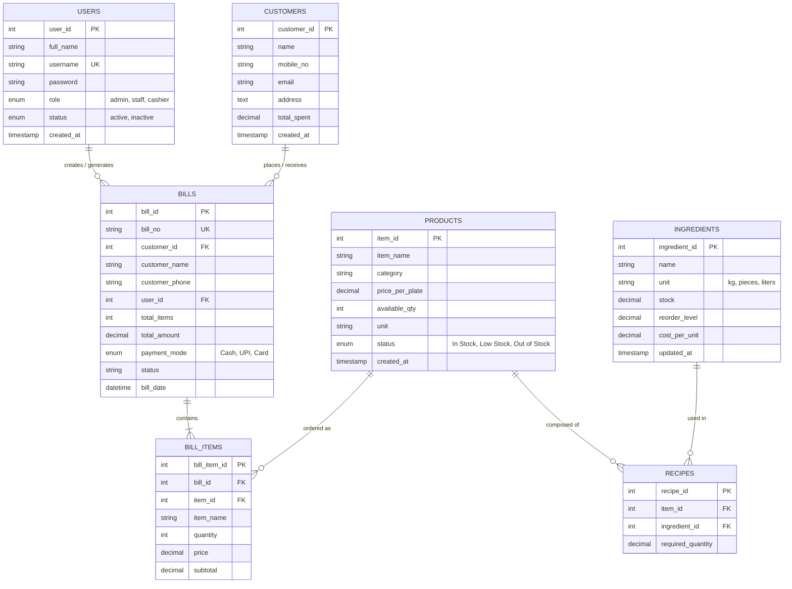

# Database Schema & Entity Relationship Documentation

**Project Title:** Inventory & Billing Software for Local Shops (Pani Puri Shop)  
**Academic Context:** T.Y.BSc. IT (Semester VI) — Capstone / College Evaluation Project (CEP)  
**Affiliation:** Chembur Trombay Education Society's N.G. Acharya & D.K. Marathe College, University of Mumbai  
**Database Engine:** MySQL 8.0+ / MariaDB / SQLite  
**Character Set:** `utf8mb4` | **Collation:** `utf8mb4_unicode_ci`

---

## 1. Entity-Relationship (ER) Diagram

---

## 2. Table Specifications & Data Dictionary

### Table 1: `users`
| Field | Type | Nullable | Key | Default | Description |
|---|---|---|---|---|---|
| `user_id` | INT | NO | PRIMARY KEY (AUTO_INCREMENT) | None | Unique user identifier |
| `full_name` | VARCHAR(100) | NO | None | None | User's full name |
| `username` | VARCHAR(50) | NO | UNIQUE | None | Login handle |
| `password` | VARCHAR(255) | NO | None | None | Hashed/plain password |
| `role` | ENUM | NO | None | 'admin' | Role: admin, staff, cashier |
| `status` | ENUM | NO | None | 'active' | Account status |
| `created_at` | TIMESTAMP | NO | None | CURRENT_TIMESTAMP | Registration date |

### Table 2: `customers`
| Field | Type | Nullable | Key | Default | Description |
|---|---|---|---|---|---|
| `customer_id` | INT | NO | PRIMARY KEY (AUTO_INCREMENT) | None | Unique customer ID |
| `name` | VARCHAR(100) | NO | INDEX | None | Customer's full name |
| `mobile_no` | VARCHAR(15) | YES | INDEX | NULL | 10-digit phone number |
| `email` | VARCHAR(100) | YES | None | NULL | Contact email address |
| `address` | TEXT | YES | None | NULL | Customer street/locality |
| `total_spent`| DECIMAL(10,2)| NO | None | 0.00 | Lifetime billing total |

### Table 3: `products` (Pani Puri Item)
| Field | Type | Nullable | Key | Default | Description |
|---|---|---|---|---|---|
| `item_id` | INT | NO | PRIMARY KEY (AUTO_INCREMENT) | None | Menu item ID |
| `item_name` | VARCHAR(100) | NO | INDEX | None | Item name (e.g. Dahi Puri) |
| `category` | VARCHAR(50) | NO | INDEX | None | Category (Pani Puri, Chaat, etc.) |
| `price_per_plate` | DECIMAL(10,2) | NO | None | None | Selling price in ₹ |
| `available_qty` | INT | NO | None | 0 | Ready plate stock |
| `unit` | VARCHAR(20) | NO | None | 'Plate' | Serving unit |
| `status` | ENUM | NO | None | 'In Stock' | Stock indicator |

### Table 4: `ingredients`
| Field | Type | Nullable | Key | Default | Description |
|---|---|---|---|---|---|
| `ingredient_id` | INT | NO | PRIMARY KEY (AUTO_INCREMENT) | None | Raw material ID |
| `name` | VARCHAR(100) | NO | INDEX | None | Ingredient name |
| `unit` | VARCHAR(20) | NO | None | None | Measurement unit |
| `stock` | DECIMAL(10,2) | NO | None | 0.00 | Available quantity in kitchen |
| `reorder_level`| DECIMAL(10,2) | NO | None | 10.00 | Minimum threshold trigger |
| `cost_per_unit`| DECIMAL(10,2) | NO | None | 0.00 | Procurement unit cost |

### Table 5: `recipes`
| Field | Type | Nullable | Key | Default | Description |
|---|---|---|---|---|---|
| `recipe_id` | INT | NO | PRIMARY KEY (AUTO_INCREMENT) | None | Recipe line identifier |
| `item_id` | INT | NO | FOREIGN KEY (`products`) | None | Targeted menu product |
| `ingredient_id`| INT | NO | FOREIGN KEY (`ingredients`) | None | Targeted ingredient |
| `required_quantity`| DECIMAL(10,2)| NO | None | None | Quantity used per plate |

### Table 6: `bills`
| Field | Type | Nullable | Key | Default | Description |
|---|---|---|---|---|---|
| `bill_id` | INT | NO | PRIMARY KEY (AUTO_INCREMENT) | None | Bill primary key |
| `bill_no` | VARCHAR(30) | NO | UNIQUE | None | Invoice number (e.g. INV-100001) |
| `customer_id` | INT | YES | FOREIGN KEY (`customers`) | NULL | Customer reference |
| `customer_name` | VARCHAR(100) | NO | None | 'Walk-in' | Customer name |
| `customer_phone`| VARCHAR(15) | YES | None | NULL | Contact phone |
| `user_id` | INT | YES | FOREIGN KEY (`users`) | NULL | Cashier/staff user |
| `total_items` | INT | NO | None | 0 | Total plates/items count |
| `total_amount`| DECIMAL(10,2)| NO | None | 0.00 | Grand total (₹) |
| `payment_mode`| ENUM | NO | None | 'Cash' | Cash / UPI / Card |
| `status` | VARCHAR(20) | NO | None | 'Paid' | Invoice status |
| `bill_date` | DATETIME | NO | INDEX | CURRENT_TIMESTAMP | Billing timestamp |

### Table 7: `bill_items`
| Field | Type | Nullable | Key | Default | Description |
|---|---|---|---|---|---|
| `bill_item_id` | INT | NO | PRIMARY KEY (AUTO_INCREMENT) | None | Line item primary key |
| `bill_id` | INT | NO | FOREIGN KEY (`bills`) | None | Parent invoice |
| `item_id` | INT | NO | FOREIGN KEY (`products`) | None | Menu product |
| `item_name` | VARCHAR(100) | NO | None | None | Product name snapshot |
| `quantity` | INT | NO | None | None | Sold quantity |
| `price` | DECIMAL(10,2) | NO | None | None | Unit price at sale time |
| `subtotal` | DECIMAL(10,2) | NO | None | None | Line subtotal (₹) |

---

## 3. Database Normalization Analysis
- **1NF (First Normal Form):** All tables have atomic values, primary keys, and no repeating groups.
- **2NF (Second Normal Form):** All non-key attributes are fully functionally dependent on primary keys (eliminating composite key partial dependencies via separate `recipes` and `bill_items` junction tables).
- **3NF (Third Normal Form):** No transitive dependencies exist; customer and user details are isolated in their respective master entities and referenced via foreign keys.
